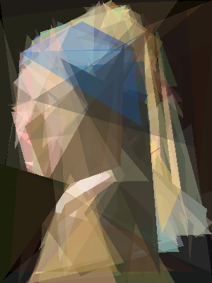

# C22_Natural_Selection

## Vermeer's *Girl with a Pearl Earring*: 100 Triangles Challenge

**Computational Intelligence for Optimization, 2025/2026**

**Group members:** Afonso Hermenegildo (20221958), Andre Ferreira (20250398), Marco Martins (20221951), Maria Francisca Goncalves (20221942)

---

## 1. Introduction

The goal of this project was to approximate the provided 300 x 400 image of Vermeer's *Girl with a Pearl Earring* using exactly 100 colored triangles. We focused on the third additional challenge in the project statement: evaluating the contribution of GA components to the overall result. The report therefore emphasizes the design choices behind the representation, fitness function, selection, crossover, mutation, and experimental comparison, rather than re-explaining the general GA workflow covered in class.

Our final submitted configuration uses a generational GA with elitism, tournament selection, uniform whole-triangle crossover, Gaussian mutation, and a population of 800 individuals evolved for 2000 generations. The best recorded solution reached **RMSE 17.9061**, improving substantially over the initial baseline run (**RMSE 39.2180**).

## 2. Representation and Fitness

### 2.1 Candidate Representation

Each individual is an ordered list of 100 triangles. A triangle is encoded by 10 genes:

```text
[x1, y1, x2, y2, x3, y3, R, G, B, A]
```

The six coordinate genes are stored directly in image pixels, with `x` bounded by the image width and `y` bounded by the image height. The four color genes store RGBA values in `[0, 255]`. The order of the triangles is part of the representation because the image is rendered sequentially: later triangles can cover earlier ones.

We considered two main representation alternatives. The first was to store normalized coordinates in `[0, 1]`; this would make distance calculations more balanced, but it would also require conversion every time an individual is rendered and would make mutation less directly interpretable in pixel units. We kept direct pixel coordinates because the rendering canvas and mutation step sizes are naturally expressed in pixels. The second alternative was to use opaque RGB triangles only. We kept alpha because transparent triangles gave the representation more expressive power, especially for soft transitions in the face, scarf, and background. This increases the search space, but the visual gain justified the extra gene.

An adaptive representation was also implemented with an eleventh gene per triangle:

```text
[x1, y1, x2, y2, x3, y3, R, G, B, A, mutation_rate]
```

This allowed us to test whether mutation rates should be evolved per triangle. It was useful as an experimental variant, but the final run used the simpler fixed-rate representation because it was easier to control and produced the best recorded long-run result.

### 2.2 Fitness Function

The project statement fixes the fitness measure as pixel-by-pixel RMSE between the original image and the rendered candidate. We followed that requirement directly:

```text
RMSE = sqrt(mean((candidate - target)^2))
```

This choice has one important consequence for interpretation: it rewards exact pixel similarity, not necessarily human-perceived similarity. Some visually plausible triangle arrangements may still have worse RMSE if local colors or edges are shifted. We did not implement an alternative perceptual color metric because our selected challenge was the evaluation of GA components, not the color-distance challenge. To keep the fitness evaluation efficient, each candidate caches its RMSE and populations are evaluated in parallel using `joblib`.

## 3. GA Design Choices

The implementation follows a generational replacement structure with protected elitism. At each generation, the best `elitism_n` individuals are copied unchanged, and the remaining population is produced through selection, crossover, and mutation. This is slightly more conservative than pure generational replacement, but it was important for this problem because a good image can be damaged easily by perturbing a few high-impact triangles.

### 3.1 Selection

We implemented roulette-wheel, rank-based, tournament, and fitness-sharing-based selection variants.

Roulette-wheel selection was adapted to minimization by inverting RMSE. We discarded it for the final run because RMSE values in later generations become close together, which weakens the contrast between individuals and makes the selection pressure less controllable. Rank-based selection avoids dependence on raw RMSE gaps and preserves diversity better, but its pressure is less direct to tune in our implementation.

Tournament selection was selected for the final configuration. The reason was practical and methodological: the tournament size gives a clear way to control selection pressure. The final implementation samples tournament contestants **with replacement**, which keeps even the weakest individual with a non-zero probability of being selected, matching the selection principle discussed in the course chapter. We tested several tournament sizes and used tournament size 10 in the final run as a compromise between weak pressure, which slowed improvement, and excessive pressure, which risked premature convergence.

Fitness sharing was also implemented to penalize crowded regions of the genotype space. The first version used raw representation distances; later notebook experiments introduced normalized distances because coordinates and color channels have different numerical scales. Fitness sharing was a valuable exploration mechanism, but it added computational overhead and did not outperform the simpler tournament setup in the best recorded final run, so it was not kept as the final selection mechanism.

### 3.2 Crossover

We implemented one-point, two-point, uniform, and geometric crossover.

The first three operators were adapted to work at **triangle boundaries** instead of arbitrary gene positions. This was a deliberate adaptation to the problem representation. Splitting inside a triangle can combine unrelated vertices, color, and alpha values, producing offspring that inherit less meaningful visual structure. Whole-triangle crossover treats each triangle as a coherent drawing primitive while still recombining larger parts of the image.

Uniform whole-triangle crossover was chosen for the final run. One-point and two-point crossover preserve longer contiguous blocks of the drawing order, but useful triangles are not guaranteed to be located near each other in the genotype. Uniform crossover mixes triangles more freely, which helped recombine partial solutions across the whole canvas. The main risk is disrupting groups of triangles that work together visually; elitism and the use of whole-triangle units reduced this risk.

Geometric crossover was implemented after revisiting the continuous-optimization part of the GA chapter. It creates offspring by taking weighted averages of parent genes and clipping values to valid bounds. This is well aligned with a real-valued representation, but for this image problem it can also average two visually distinct triangles into an intermediate triangle that is not useful. For that reason, it was treated as an experimental alternative rather than the final choice.

The strongest statistical result currently stored in the notebook is the comparison between one-point and uniform crossover: both samples passed the normality check, and Welch's t-test gave **p = 0.0018**, with mean final RMSE **39.1120** for one-point and **35.3974** for uniform over 30 runs. This supports the final choice of uniform crossover.

### 3.3 Mutation

We implemented six mutation variants:

| Mutation operator | Intended contribution |
|---|---|
| Full Gaussian mutation | Jointly refines geometry and RGBA values. |
| Color-only Gaussian mutation | Improves colors without disturbing triangle placement. |
| Vertex-only Gaussian mutation | Adjusts shapes without changing colors. |
| Per-gene reset mutation | Injects random gene-level novelty. |
| Per-triangle reset mutation | Replaces entire triangles for stronger exploration. |
| Layer-swap mutation | Changes occlusion order without changing triangle content. |

The final run used full Gaussian mutation. The image approximation problem benefits from small continuous changes once the main structure is visible. Gaussian mutation behaves like a local search step in the real-valued genotype: coordinates and color values are perturbed and then clipped to valid ranges. Color-only and vertex-only mutation were too narrow as standalone operators because both shape and color need to co-evolve. Reset mutations were useful for exploration but too destructive once good triangles had emerged. Layer-swap mutation addressed a real issue, namely occlusion order, but it cannot improve color or geometry by itself, so it was not used as the only mutation operator in the final run.

We also tested mutation-rate decay and the self-adaptive mutation-rate representation. High initial mutation with decay improved early movement in short runs, but the best recorded final long run used a fixed rate of **0.01**. The final curve was still improving late in the run, which suggests that this rate preserved enough variation for refinement without repeatedly destroying useful triangles.

## 4. Experimental Methodology

Following the experimental-comparison guidance from the course chapter, we avoided drawing conclusions from a single stochastic run. The notebook includes a helper that repeats each configuration over independent runs, stores the best RMSE history for each run, and plots the average best fitness with standard-deviation bands. The updated helper also stores the final best RMSE values per run and includes a normality check followed by either a Welch t-test or a non-parametric alternative.

The selected project challenge was the evaluation of GA components. We compared:

| Component | Values compared |
|---|---|
| Selection | Roulette wheel, rank-based, tournament with multiple tournament sizes |
| Crossover | One-point, two-point, uniform, geometric |
| Mutation | Full Gaussian, color Gaussian, vertex Gaussian, gene reset, triangle reset, layer swap |
| Mutation-rate strategy | Fixed rate, decay schedules, self-adaptive mutation-rate gene |
| Population size | 200, 400, 800, 1500 |

One caveat is important. The chapter warns that configurations with different population sizes should be compared by computational effort, commonly the number of fitness evaluations, rather than by generation count alone. Our population-size experiment is therefore best interpreted as exploratory tuning, not as a fully fair performance comparison. For the operator comparisons, the population size and number of generations were kept fixed, so comparing average best RMSE by generation is methodologically cleaner.

The baseline configuration used population 50, 200 generations, tournament selection, one-point crossover, Gaussian mutation, crossover rate 0.9, mutation rate 0.02, and elitism 2. It reached **RMSE 39.2180**. Larger and more refined configurations improved strongly: a fitness-sharing run with population 800 and 1000 generations reached **RMSE 22.4320**, and a normalized-sharing / layer-swap variant reached **RMSE 22.3807**. The final configuration without sharing but with uniform crossover, tournament size 10, population 800, and 2000 generations reached **RMSE 17.9061**.

**TODO before final PDF:** export the comparison plots from the notebook and add one short interpretation below each figure. The most important figures are crossover comparison, mutation comparison, mutation-rate strategy, and final convergence. For population size, label it explicitly as an exploratory comparison unless the runs are redone using equal fitness-evaluation budgets.

## 5. Final Result

The final image was saved as `best_result.png`.



The final candidate captures the main composition of the painting: dark background, face region, head covering, clothing, and the approximate pearl location. Some local details remain imprecise, but this is consistent with the constraint of using only 100 triangles and optimizing pixel RMSE rather than semantic similarity.

The final RMSE was **17.9061**. Compared with the baseline RMSE of **39.2180**, this corresponds to an approximate **54.3%** reduction:

```text
(39.2180 - 17.9061) / 39.2180 = 0.5434
```

The improvement came from three main decisions: increasing the computational budget, using tournament selection with controlled pressure, and replacing one-point crossover with uniform whole-triangle crossover. Gaussian mutation remained central because the representation is continuous and local perturbations are meaningful for both triangle geometry and color.

## 6. Conclusion

The final implementation solves the assigned problem with a real-valued, fixed-length representation of 100 semi-transparent triangles and an RMSE objective consistent with the project statement. The main adaptation was to make genetic operators respect the triangle structure: crossover works on whole triangles, and mutation perturbs bounded coordinate and RGBA genes in a way that matches the rendering domain.

Our component evaluation supports the final design. Tournament selection was kept because it gives explicit control over selection pressure. Uniform whole-triangle crossover was kept because it significantly outperformed one-point crossover in the stored 30-run comparison. Full Gaussian mutation was kept because it provides the broadest useful local refinement among the mutation variants tested. More complex additions, such as fitness sharing, self-adaptive mutation rates, layer-swap mutation, and geometric crossover, were implemented and considered, but not retained in the final run because they either added overhead, were less stable, or did not improve the best recorded result.

For future work, the most promising improvement would be smarter initialization, for example sampling triangle colors from the target image. A second useful extension would be a final local-search phase applied only to the best GA result. Both should be evaluated under equal fitness-evaluation budgets to keep the comparison fair.

## Appendix: Reproducibility Notes

| File | Purpose |
|---|---|
| `scripts/triangle_sol.py` | Solution representation, rendering, adaptive representation, and RMSE fitness |
| `scripts/ga.py` | Main generational GA with elitism and optional mutation-rate decay |
| `scripts/ga_utils.py` | Fitness caching and parallel population evaluation |
| `operators/selection.py` | Roulette, rank-based, and tournament selection |
| `operators/crossover.py` | One-point, two-point, uniform, and geometric crossover |
| `operators/mutation.py` | Gaussian, reset, and layer-swap mutation operators |
| `operators/fitness_sharing.py` | Fitness-sharing diversity utilities |
| `scripts/statistical_comparison.py` | Repeated-run comparison, plotting, and statistical testing |
| `main_nb.ipynb` | Experiments, plots, and final run |

The final run is reproduced by executing the final GA section in `main_nb.ipynb` after loading `project_info/girl_pearl_earing.png` into `TriangleSolution.target_array`.
